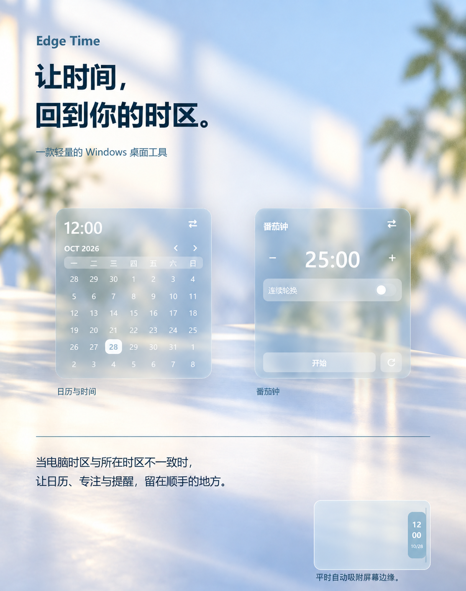

# Edge Time

当电脑时区和您所在时区不一致时，可以使用这一款轻量级的小软件。它贴在屏幕边缘，内置时钟、日历、番茄钟和自定义提醒。



## 功能

- 点击边缘小窗展开；拖动折叠小窗可调整屏幕边缘的位置。
- 选择 IANA 时区，启动时自动联网校准，也可以在设置里手动校准；支持 12 / 24 小时制与秒数开关。
- 查看月历，切换月份；番茄钟可单次计时或交替运行两个时长。
- 分别自定义第一段和休息段结束时的提醒文字。
- 常驻系统托盘，可在设置中关闭开机启动。

时区规则由应用自带的 IANA 数据库提供，时间通过 NTP 校准，不会修改电脑系统时钟。启动时若尚未校准且网络不可用，会显示 `--:--`；校准成功后，本次运行中临时断网仍可继续显示。退出或重启应用会重置正在进行的计时。

## 下载

[下载 Windows x64 自包含版](https://github.com/LunariaFlora/edge-time/releases/latest)：包含运行环境，解压后即可运行，无需另行安装 .NET。

## 使用

面向 Windows x64。解压分享包后保持文件夹完整，运行 `EdgeTime.exe`。右键任务栏隐藏图标中的闹钟图标可打开设置或退出。默认开启当前用户的开机启动，设置中可关闭；移动或删除应用前请先关闭开机启动。

## 从源码构建

需要 .NET 10 SDK、Visual Studio C++ 桌面开发工具及 Windows SDK。运行 `build-native.cmd`，它先编译 `native/GlassEffect.cpp`，再构建 WPF 应用。运行时需要将生成的 `GlassEffect.dll` 与可执行文件放在一起。

```powershell
.\build-native.cmd
dotnet run --project .\EdgeTime.csproj -c Release
```

自包含分享包示例：

```powershell
dotnet publish .\EdgeTime.csproj -c Release -r win-x64 --self-contained true -p:PublishSingleFile=true -p:IncludeNativeLibrariesForSelfExtract=true -o .\publish
```

源码中不包含本机偏好设置、用户数据或已编译产物。演示视频由 `media/render_demo.py` 生成，需要 Python、Pillow 与 FFmpeg；它是代码绘制的产品演示，不是实际桌面录屏。

## 使用的组件

- [Noda Time](https://github.com/nodatime/nodatime)，Apache-2.0，包含 IANA 时区数据；许可见 `licenses/Apache-2.0.txt`。
- 磨砂效果的 Windows 合成互操作参考了 [Microsoft Windows.UI.Composition Win32 Samples](https://github.com/microsoft/Windows.UI.Composition-Win32-Samples)。
- 校时使用 [Cloudflare NTP](https://developers.cloudflare.com/time-services/ntp/)；首选服务不可用时尝试备用服务。
